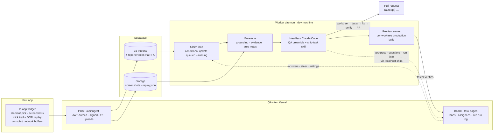

# Agentic QA-to-PR Pipeline

**A tester files a bug from inside your app. An autonomous Claude Code agent reproduces it as that tester's role, fixes it in an isolated worktree, opens a PR, and serves a live preview the tester verifies. Humans only merge.**

[How a bug becomes a PR](#how-a-bug-becomes-a-pr) · [Components](#components) · [Design decisions](#design-decisions) · [Safety rails](#safety-rails) · [Bring your own app](#bring-your-own-app) · [Run it](#run-it)


Most "AI fixes bugs" demos start from a well-written ticket. Real QA doesn't. This pipeline starts one step earlier — at the moment a tester notices something wrong — and captures the evidence an engineer would otherwise spend an hour reconstructing: the exact element, the console and network buffers from page load, a recorded click trail with a DOM replay, pre-marked screenshots, and the reporter's permission role. That envelope is what the agent receives. Every fix lands as a PR with a feature test, behind a verify gate, on a per-task preview URL. It is app-agnostic: point it at your Supabase project and your repo.

## How a bug becomes a PR



Inside the agent, every report pays for **grounding** first — read the screenshots as images, trace the vertical slice, reproduce the failing request with `curl`, act as the reporter's role — then a **risk-tiered router** decides how heavy the pipeline gets:

| Tier | Signal | Pipeline |
|---|---|---|
| 0 · trivial | docs, copy | edit directly |
| 1 · small | one obvious fix | one focused test, then fix (TDD) |
| 2 · standard | feature / bugfix | **blind test agent** (never sees the implementation) → separate implement agent → verify gate |
| 3 · large / ambiguous | multi-file, unclear spec | Tier 2 + adversarial review; stops and asks if acceptance criteria are untestable |

A **risk floor** forces anything touching auth, tenancy, migrations or payments to Tier 2+. Doubt tiers up, never down. All tiers land the same way: verify gate → independent feature test → branch → push → PR → preview.

## Components

```
apps/site/        Next.js (App Router, Tailwind v4) — board, task pages, ingest API, capture frame, serves widget.js
packages/widget/  dependency-free TypeScript → esbuild IIFE, ≤80 KB gzipped — the in-app reporter
worker/           Node 22 ESM daemon — claim · envelope · dispatch · shim · previews · tunnels · reconcile · self-test
agent/            node-pty bridge: attach a real Claude Code terminal to a task from the web page
db/               20 SQL migrations — schema, RLS, security-definer RPCs, settings, lanes, previews
contracts/        CONTRACTS.md — single source of truth for every interface between the three runtimes
docs/             DATA-FLOW.md · ROUTING.md
```

| Piece | What it does |
|---|---|
| **Widget** | Records rolling console/network buffers from page load; element pick resolves selector → component → source file; ⏺ Start/Finish recording captures a click trail (passwords masked) plus an rrweb DOM replay; screenshots are pre-marked on the picked element. Frame-gated loader with a postMessage handshake so your app never ships the reporter to end users. |
| **Ingest** | Validates a per-host JWT, optionally enriches the report with the reporter's roles via a security-definer RPC you provide, streams binaries to Storage through signed URLs (bypassing the 4.5 MB serverless body cap), inserts `queued`. |
| **Worker** | Polls and claims with a conditional update (no double-dispatch), downloads evidence to local files, writes `envelope.json`, launches headless `claude` with a QA preamble, exposes a localhost **shim** the run calls for progress beacons, run info and `ask` (questions relay to the board and answers flow back), serves a production-build **preview** per worktree (local or Cloudflare tunnel), and on boot re-attaches detached runs that survived a restart (found by session UUID in argv) or blocks the report if they didn't. |
| **Board** | Lanes, assignees, live run log, the agent's questions inbox, "Test this" preview embed, steer / interrupt, mark-shipped, and operator settings (`max_runs`, `max_previews`) that the worker hot-reloads every 10 s. |
| **Terminal agent** | One click opens the run's *actual* Claude Code session (`--resume`, or `--fork-session` if still live) in its worktree on your machine; on anyone else's machine, a fresh session seeded with the task. |

## Design decisions

- **Evidence over description.** The agent gets what a senior engineer would collect before touching code — not the tester's paraphrase of it.
- **Role-faithful reproduction.** If your project exposes `qa_reporter_roles(uid)`, each report carries the reporter's roles and the agent is instructed to reproduce and verify *as that role* — a bug an org admin hits may be invisible to a regular member, and permission gates are frequent root causes.
- **Blind tests, separate implementer.** The agent that writes the failing test never sees the implementation; a fresh verifier writes one integration test of the key behavior after the build is green.
- **Isolation by construction.** Every run is its own git worktree off the base branch; every preview is its own production build on its own port; nothing runs in the main checkout.
- **Operators stay in the loop without being in the inner loop.** Questions the agent can't answer from the repo surface on the board; everything else proceeds. Concurrency and preview caps are edited live from the UI, not redeployed.
- **Humans merge.** The pipeline stops at PR-ready, every time.

## Safety rails

- Preview builds accept an **anon** Supabase key only — the worker decodes the JWT and refuses `service_role`.
- Shim and terminal agent bind to `127.0.0.1` with an origin allowlist; no tunnel, no port forward.
- Click-trail recording masks password fields; DOM replay is size-capped.
- Daily run cap and concurrency cap (`RUNS_PER_DAY`, `max_runs`), single-flight claims, boot reconciliation of in-flight runs.
- The worker never writes DNS for the preview zone's apex, `www`, `api`, `app`, `qa`, or anything in `PROTECTED_HOSTS`.
- Testers self-enroll with a rotating team access code; row-level security on all 12 tables, service-role access confined to server routes and security-definer RPCs.

## Bring your own app

Nothing here is tied to a particular product. What the pipeline needs from yours:

| Requirement | Why |
|---|---|
| A **Supabase project** your app already uses for auth | Testers sign in to the QA site with their existing accounts; the pipeline adds only `qa_`-prefixed tables, RPCs and one storage bucket |
| A **git repo** with the `ship-task` Claude Code skill installed, cloned on the worker machine | That's what the agent runs in; worktrees are created off its base branch |
| A **Next.js web app** buildable inside a worktree (`PREVIEW_BUILD_CMD`, default `npm run build`; `PREVIEW_APP_DIR` if it lives in a subdirectory) | Each preview is a production build of the fixed branch, served with `next start` |
| The **widget loader** in your app (one frame-gated `<script>`, protocol in `packages/widget/README.md`) | Reports are filed from inside the running app, with evidence |
| Optional: `qa_reporter_roles(uid)` RPC + `profiles` table | Role-faithful reproduction |
| Optional: a `/qa-session` page accepting a magic-link `token_hash` | Preview embeds sign the tester in without credentials |
| Optional: `data-component` / `data-element` / `data-source-file` attributes from your build | Element pick lands on a source file, not just a selector |

Configuration is entirely environment variables — see `apps/site/.env.example` and `worker/.env.example`; every interface is specified in [`contracts/CONTRACTS.md`](contracts/CONTRACTS.md).

## Run it

```bash
npm install
npm run build:widget            # → apps/site/public/widget.js
npm run dev                     # QA site on :3200
npm run dev:worker              # worker daemon (needs worker/.env)
npm run selftest                # end-to-end against real tables with a mock dispatcher:
                                # queued → running → pr_ready → preview → verified,
                                # plus destroy and blocked legs; cleans up after itself
```

Full setup — migrations, deploy, worker as a service, tunnel previews, widget integration — is in [`SETUP.md`](SETUP.md).

## Status

Running in production for a multi-tenant SaaS since July 2026. Known gaps: previews assume a Next.js app (`next start`, `.next/BUILD_ID`); the worker is exercised on macOS (launchd), with Linux via systemd documented but less tested.

## License

Source-available, all rights reserved — see [LICENSE](LICENSE). You may read the code and run it for personal, non-commercial evaluation; production or commercial use requires written permission.
