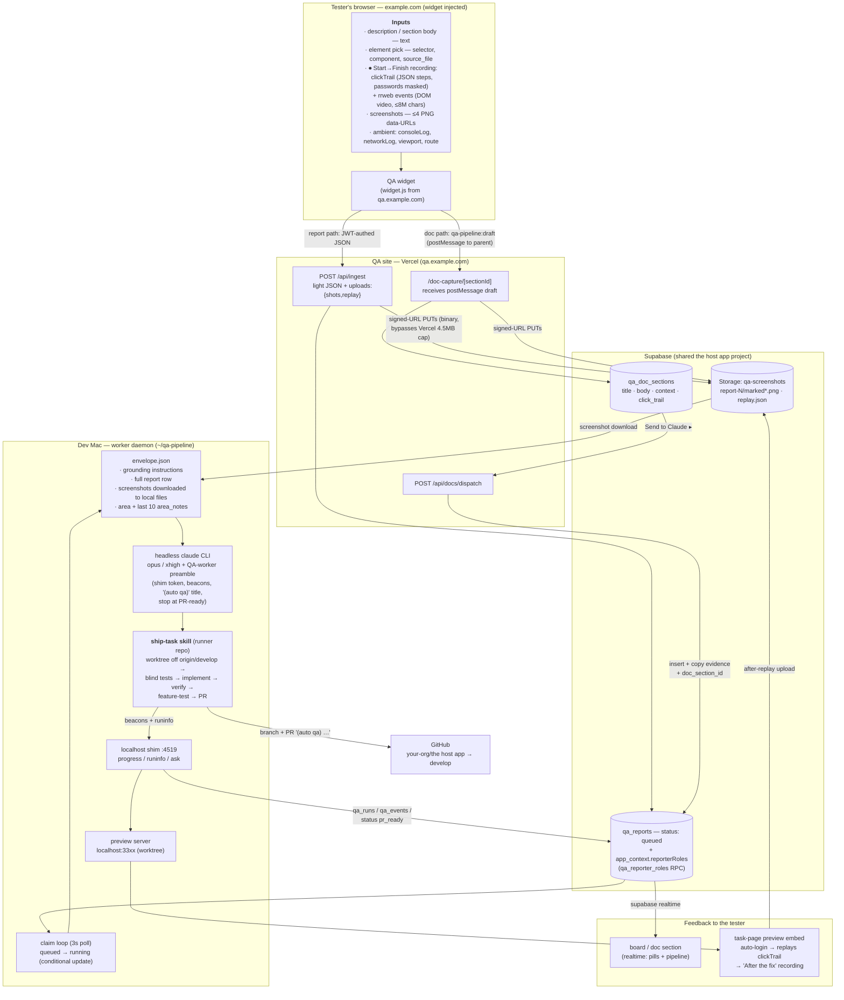

# Data flow — tester input → Claude's ship-task skill

From what the tester types/clicks/records in the browser, through Supabase, to the
headless `claude` run on the dev Mac — and the results flowing back.

## How Claude consumes each input type

| Input | Consumed as |
|---|---|
| description / section body | the task statement, verbatim (+ `[from doc …]` trailer) |
| selector / component / source_file | entry point for the code trace — never assumed to be the bug's location |
| screenshots | read **as images** (Read tool) before any edit |
| clickTrail | reproduction steps; later re-executed on the preview for the After recording |
| networkLog | the exact failing request — replayed with curl to reproduce & verify |
| rrweb recording | never parsed by Claude — human players only (Before / After tabs) |
| reporterRoles | Claude reproduces and verifies **as that role** (RBAC bugs) |
| area_notes | lessons from previous QA runs in the same code area |
